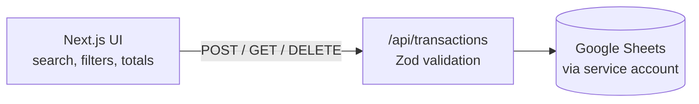

# Finance Tracker

A personal income and expense tracker I built for myself. Add a transaction, see it categorised and totalled in my reporting currency, and keep the data in a Google Sheet I fully own.

**Live:** <https://finance-tracker-inky-theta-92.vercel.app>



## Features

- Income and expenses across **12 currencies** (SGD, USD, EUR, GBP, JPY, AUD, MYR, CNY, HKD, KRW, THB, IDR) with a selectable reporting currency
- 11 categories with colour and emoji, plus search and filters by type and category
- **Soft delete** behind a confirmation modal, so nothing is lost by accident
- Google Sheets as the database: readable, exportable and editable by hand

## Stack

Next.js 16, React 19, TypeScript, Tailwind CSS, Zod, `googleapis`.

## Run it

```bash
npm install
npm run dev     # http://localhost:3000
```

Create a Google service account, share your Sheet with its email, and set `GOOGLE_SHEET_ID`, `GOOGLE_SERVICE_ACCOUNT_EMAIL` and `GOOGLE_PRIVATE_KEY` in `.env.local`. The app refuses to start without them.
